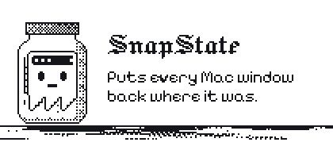
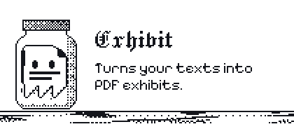
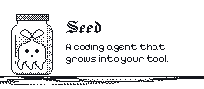
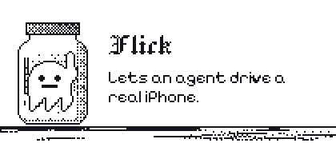
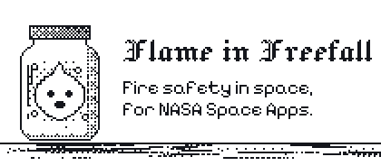
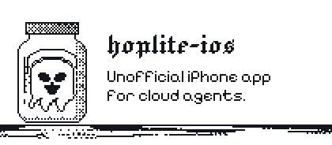

<picture><source media="(prefers-color-scheme: dark)" srcset="assets/hero-dark.svg"></picture>

<a href="https://getsnapstate.com"><picture><source media="(prefers-color-scheme: dark)" srcset="assets/snapstate-dark.svg"></picture></a><a href="https://chatexhibit.me"><picture><source media="(prefers-color-scheme: dark)" srcset="assets/exhibit-dark.svg"></picture></a><a href="https://github.com/SoulSniper-V2/seed"><picture><source media="(prefers-color-scheme: dark)" srcset="assets/seed-dark.svg"></picture></a><a href="https://github.com/SoulSniper-V2/flick"><picture><source media="(prefers-color-scheme: dark)" srcset="assets/flick-dark.svg"></picture></a><a href="https://soulsniper-v2.github.io/flame-in-freefall/"><picture><source media="(prefers-color-scheme: dark)" srcset="assets/flame-dark.svg"></picture></a><a href="https://github.com/SoulSniper-V2/hoplite-ios"><picture><source media="(prefers-color-scheme: dark)" srcset="assets/hoplite-dark.svg"></picture></a>

Still loose: [hoplite-acp-bridge](https://github.com/SoulSniper-V2/hoplite-acp-bridge), [agent-relay](https://github.com/SoulSniper-V2/agent-relay), [tuck](https://github.com/SoulSniper-V2/tuck) and [vulkancut](https://github.com/SoulSniper-V2/vulkancut).
